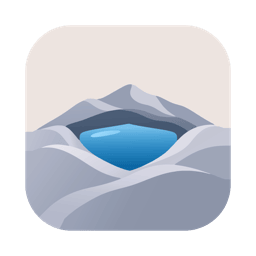
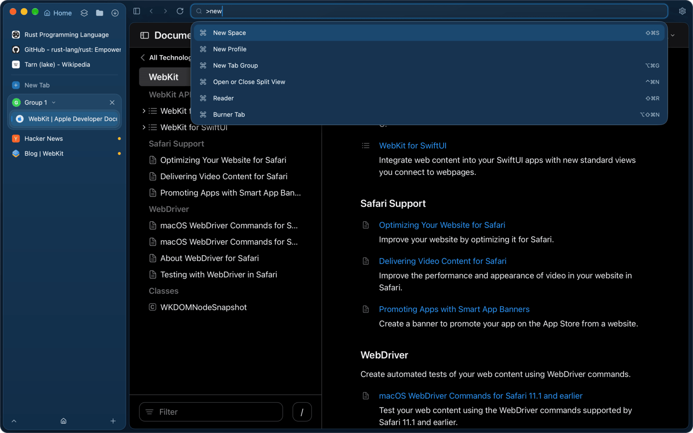
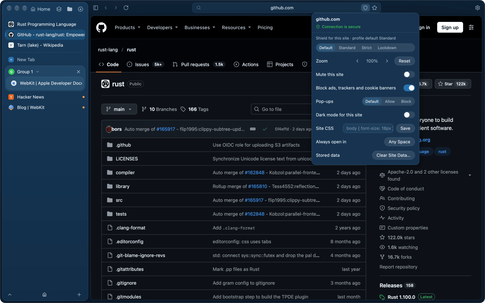
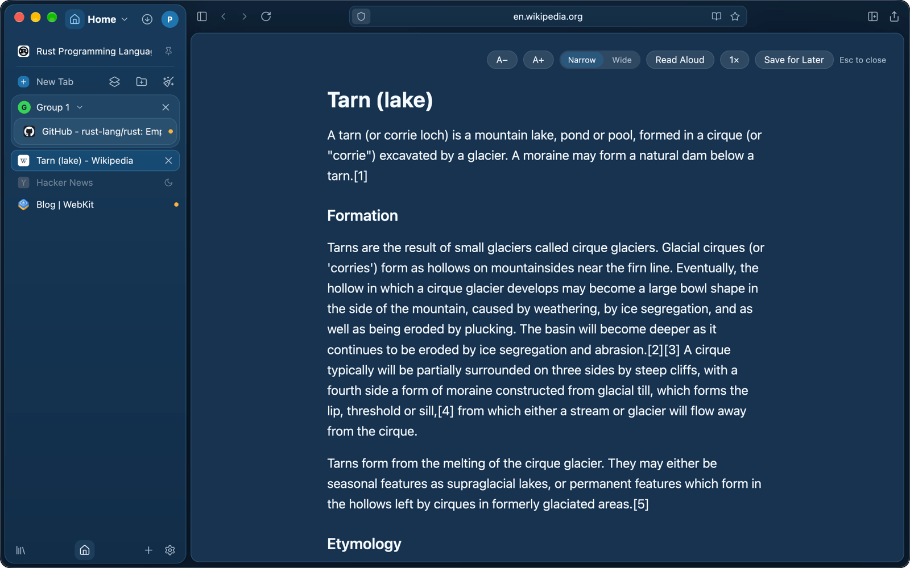
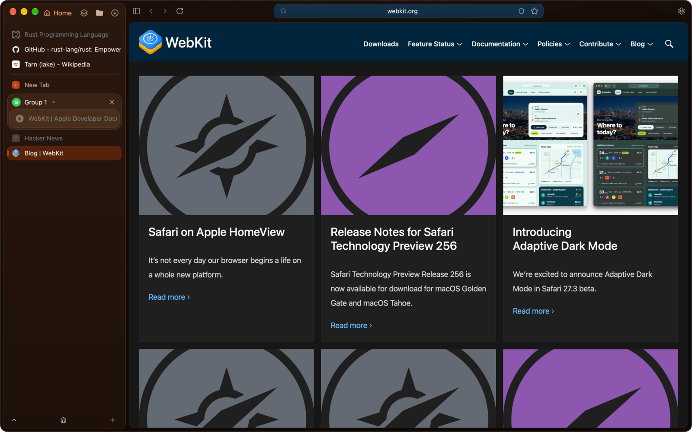
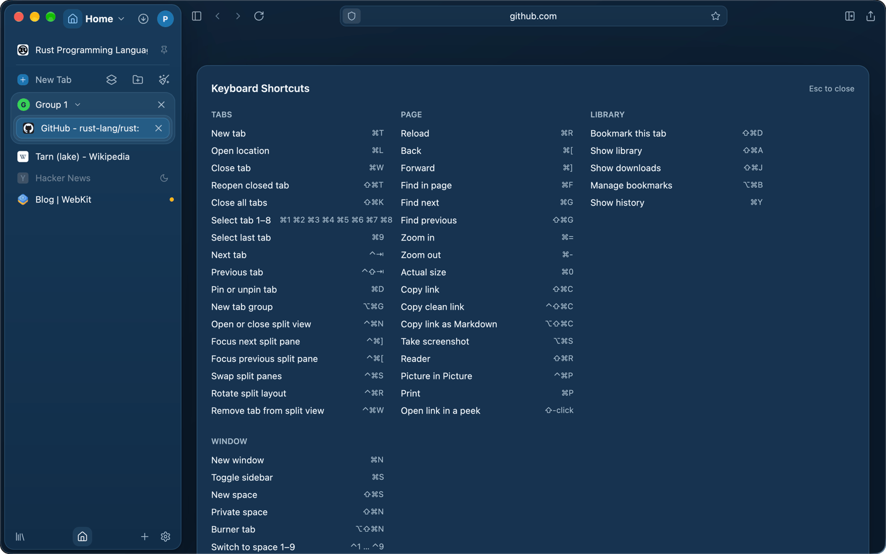

<div align="center">



# Tarn

**A fast, private browser with a native interface on every platform.**<br>
Written in Rust. No telemetry, no accounts, no Electron.

[](https://github.com/Quavon-dev/tarn-browser/actions/workflows/ci.yml)
[](https://scorecard.dev/viewer/?uri=github.com/Quavon-dev/tarn-browser)
[](LICENSE)


[Features](#features) · [Screenshots](#screenshots) · [Platforms](#platforms) · [Build](#build-and-run) · [Shortcuts](#shortcuts) · [Development](#development)

<a href="docs/media/demo.mp4"></a>

<sub>▶ Full-quality video: <a href="docs/media/demo.mp4">docs/media/demo.mp4</a></sub>

</div>

> [!NOTE]
> **Status:** pre-1.0. Features, settings and stored data can change between releases without a
> migration path. There are no published releases yet; build from source.

## Features

<table>
<tr>
<td width="50%" valign="top">

### 🛡️ Private by default
**Shield** blocks trackers and ads, strips tracking parameters and keeps pages off your local
network. **Strict** adds HTTPS-only and no cross-site referrer; **Lockdown** turns off JavaScript
and keeps no site data. Every level can be set per site.

</td>
<td width="50%" valign="top">

### 🧱 Blocking you can switch
Ads (EasyList, AdGuard and uBlock filters, placeholders hidden), trackers, cookie banners, YouTube
ads, pop-ups and pop-up redirects, malware, phishing and scam sites, and adult sites if you want.
Lists are signed and updated daily; dangerous sites get a warning page drawn by Tarn.

</td>
</tr>
<tr>
<td valign="top">

### ⌨️ Keyboard first
One field for addresses, search, open tabs and app actions, with inline completion. A shortcut for
nearly everything, most of them rebindable; <kbd>⌘</kbd><kbd>/</kbd> lists them all.

</td>
<td valign="top">

### 🗂️ Spaces and profiles
Each space has its own name, colour and icon; profiles keep cookies, history and site data fully
apart. Private spaces and burner tabs live in memory only. Hosts can be routed to a space.

</td>
</tr>
<tr>
<td valign="top">

### 🪟 Tabs that stay out of the way
Vertical tabs, pinned tabs that remember their page, tiles, folders, tab groups, Split View and
link peek. Unused tabs sleep, and the heaviest background tabs sleep once they use over 1 GB (macOS).

</td>
<td valign="top">

### 🎨 Yours to restyle
Built-in themes, a colour editor and themes from a file, the clipboard, GitHub or the official
catalog. Reader view, per-site zoom, dark mode and CSS, Picture in Picture and extensions.

</td>
</tr>
</table>

Native on every platform: GPUI draws the macOS and Windows interface, and the same Rust core runs
the Linux, iOS and Android apps. Pages render in each platform's own engine.

## Screenshots

<table>
  <tr>
    <td width="50%"></td>
    <td width="50%"></td>
  </tr>
  <tr>
    <td align="center"><sub><b>Sidebar</b> · pinned tabs, groups and sleeping tabs</sub></td>
    <td align="center"><sub><b>One field</b> · addresses, search and Switch to Tab</sub></td>
  </tr>
  <tr>
    <td></td>
    <td></td>
  </tr>
  <tr>
    <td align="center"><sub><b>Commands</b> · type <code>&gt;</code> or an action name</sub></td>
    <td align="center"><sub><b>Split View</b> · <kbd>⌃⌘N</kbd></sub></td>
  </tr>
  <tr>
    <td></td>
    <td></td>
  </tr>
  <tr>
    <td align="center"><sub><b>Site settings</b> · Shield level and permissions per site</sub></td>
    <td align="center"><sub><b>Reader</b> · <kbd>⇧⌘R</kbd>, with Read Aloud</sub></td>
  </tr>
  <tr>
    <td></td>
    <td></td>
  </tr>
  <tr>
    <td align="center"><sub><b>Themes</b> · Ember, one of the built-in themes</sub></td>
    <td align="center"><sub><b>Shortcut sheet</b> · <kbd>⌘/</kbd></sub></td>
  </tr>
</table>

## Platforms

macOS is the lead client; every feature ships on all five in the same change.

| Platform | Interface | Web engine | Requires |
|---|---|---|---|
| **macOS** | GPUI | System WebKit (Chromium optional) | macOS 14 Sonoma or later, Apple silicon or Intel |
| **Windows** | GPUI | Chromium (CEF) | Windows 10 or 11, x64 |
| **Linux** | [Native Shell](https://nsh.dev/) | WebKitGTK 6.0 | Debian 13, Ubuntu 26.04, Fedora 43 or Arch |
| **iOS / iPadOS** | Native Shell | `WKWebView` | iOS 17 or later |
| **Android** | Native Shell | System WebView | Android 9 or later |

Shared by all of them: `browser-core` (state and decisions), `engine`, `shield` (blocking and
policy), `store` and `sync`. Contract: [`docs/shared-core.md`](docs/shared-core.md); security
model and per-platform differences: [`docs/threat-model.md`](docs/threat-model.md).

## Build and run

### macOS

Needs the Xcode command line tools and the Rust toolchain pinned in `rust-toolchain.toml` (rustup
installs it on first use).

```sh
cargo run -p app --release
cargo run -p app -- https://example.com   # open a URL in a new tab
```

Profile data lives in `~/Library/Application Support/Tarn`; set `TARN_DATA_DIR` to use another
directory. Debug builds also read `TARN_TEST_FILTER_KEY`, a 64-digit hex Ed25519 public key that
replaces the filter-list signing key so tests can install bundles they signed themselves, and
`TARN_TEST_CATALOG_KEY`, which replaces the extension catalog's signing key in the same way;
release builds ignore both.

### Windows

From Git Bash with the MSVC toolchain; Chromium comes from the pinned CEF build:

```sh
export CEF_PATH="$(cygpath -w "$(scripts/fetch-cef.sh windows64)")"
cargo run -p app --release
```

Details, installer and signing: [`docs/windows-plan.md`](docs/windows-plan.md).

### Linux, iOS and Android

Each has its own Cargo workspace on [Native Shell](https://nsh.dev/) 0.5.0, so NSH stays out of the
root workspace.

| Directory | What |
|---|---|
| `nsh-shared/` | Theme tokens, icons and controls shared by the three apps (`cargo test` there) |
| `linux/` | The Linux desktop app ([`linux/README.md`](linux/README.md)) |
| `mobile/` | The phone and tablet app (`app/`), the iOS web view (`ios/`) and the Android host app (`android/`, [`mobile/android/README.md`](mobile/android/README.md)) |

```sh
# Linux, in a Fedora 43 container (no Linux desktop needed)
docker build -t tarn-linux-fedora -f linux/docker/fedora.Dockerfile linux/docker
linux/scripts/cargo.sh test --locked && linux/scripts/test-display.sh
linux/packaging/build-all.sh deb-debian|deb-ubuntu|rpm|arch    # .deb, .rpm, AUR package

# Mobile (nsh 0.5.0 on PATH: https://nsh.dev/docs/installation)
cd mobile && cargo test --locked                               # shell and UI tests on the host
cd mobile/app && nsh package --target ios-simulator            # iOS simulator app
mobile/android/build.sh                                        # debug APK (ANDROID_HOME, NDK, JDK 17+)
```

Packages: `.deb` for Debian 13 and Ubuntu 26.04, `.rpm` for Fedora 43 and an AUR `PKGBUILD`, each
depending on the distribution's WebKitGTK 6.0; no Flatpak or AppImage. The iOS and Android apps have
no signed or store builds yet. Plans: [`docs/nsh-plan.md`](docs/nsh-plan.md) and
[`docs/mobile-plan.md`](docs/mobile-plan.md).

Verified so far: the Linux app in Docker under Xvfb (Fedora 43; packages installed and started on
Debian 13, Ubuntu 26.04, Fedora 43 and Arch); the mobile app in the iOS simulator (iPhone 17, iPad
Pro 13-inch) and the Android emulator (phone and 10-inch tablet, Android 16). Not yet: a real Linux
desktop, HiDPI, IME, VoiceOver and TalkBack, physical iPhones, iPads or Android devices, and amd64
Linux packages.

## Shortcuts

The macOS defaults (Windows and Linux use <kbd>Ctrl</kbd> where macOS uses <kbd>⌘</kbd>). Most can
be changed in Settings › Shortcuts; tab and space numbers, Esc, Undo/Redo and ⌘Q stay fixed.

| | |
|---|---|
| <kbd>⌘T</kbd> / <kbd>⌘L</kbd> | New tab / edit the current address |
| <kbd>⌘W</kbd> / <kbd>⇧⌘T</kbd> | Close tab / reopen closed tab |
| <kbd>⌘1</kbd> … <kbd>⌘9</kbd> · <kbd>⌃⇥</kbd> | Select a tab · next tab |
| <kbd>⌃1</kbd> … <kbd>⌃9</kbd> | Switch space |
| <kbd>⌃⌘N</kbd> | Split View |
| <kbd>⇧</kbd>-click a link | Link peek |
| <kbd>⇧⌘R</kbd> | Reader |
| <kbd>⌘S</kbd> | Show or hide the sidebar |
| <kbd>⇧⌘N</kbd> | Private space |
| <kbd>⌘/</kbd> | All shortcuts |

<details>
<summary><b>Full shortcut list</b></summary>

| Keys | Action |
|---|---|
| ⌘N | New window |
| ⌘T | New tab: the address field opens in the toolbar over a shown page, otherwise the command card, with the cursor in it |
| ⌘L | Edit the current tab's address in the toolbar |
| ⌘W | Close tab (pinned tabs and tiles are unloaded, not removed) |
| ⇧⌘T | Reopen closed tab |
| ⇧⌘K | Close all tabs |
| ⌘1 … ⌘8 / ⌘9 | Select tab 1–8 / the last tab (in sidebar order) |
| ⌃⇥ / ⌃⇧⇥ | Next / previous tab (wraps around) |
| ⇧⌘C | Copy link of the current tab |
| ⌥⇧⌘C | Copy link as Markdown, `[title](url)` (Copy Title is in the Tabs menu) |
| ⌃⌘N | Open or close Split View: the current tab beside the space's last used tab outside a split, or a copy of it |
| ⌃⌘] / ⌃⌘[ | Focus the next / previous split pane |
| ⌃⌘S | Swap the focused split pane with the next one |
| ⌃⌘R | Rotate the split layout: side by side or stacked |
| ⌃⌘W | Remove the current tab from Split View |
| ⌥⌘S | Screenshot of the visible page to Downloads and the clipboard (Save Page as PDF is in the File menu) |
| ⌃⌘P | Picture in Picture for the page's largest playing video |
| ⌘/ | Keyboard shortcut cheat sheet |
| ⌘D | Pin or unpin the current tab |
| ⌥⌘G | New tab group (with the current tab) |
| ⇧⌘D | Bookmark the current tab |
| ⇧⌘A | Library: open tabs, history and bookmarks |
| ⇧⌘J | Recent downloads |
| ⌥⌘B / ⌘Y | Manage bookmarks / show history (open the library) |
| ⇧⌘R | Reader |
| ⌥⇧⌘N | Burner tab |
| ⌘M | Minimize the window |
| ⌃⌘F | Enter or exit full screen |
| ⌘H / ⌥⌘H | Hide Tarn / hide other apps (Show All is in the Tarn menu) |
| ⌘[ / ⌘] | Back / forward |
| ⌘R | Reload (the arrow spins while the page loads) |
| ⌘F / ⌘G / ⇧⌘G | Find in page / next / previous |
| ⌘P | Print |
| ⌘S | Show or hide the sidebar |
| ⌘, | Settings window (Shield level, site overrides, history); ⌘W or Esc closes it |
| ⌘= / ⌘- / ⌘0 | Zoom in / out / reset |
| ⌃1 … ⌃9 | Switch space |
| ⇧⌘S | New space: pick a profile or create a new, fully separate one; name, colour and icon |
| ⇧⌘N | Private space (memory only) |
| ⌘Z / ⇧⌘Z | Undo / redo |
| ⇧-click a link | Open it in a peek over the page; Open in Tab keeps its history, Esc or a click outside closes it |

Trackpad (Settings › Tabs › Trackpad gestures): swipe left or right over the sidebar to switch
spaces; swipe over the address field to step through tabs; swipe right over the toolbar to show the
sidebar. The mouse's back and forward buttons always navigate.

</details>

<details>
<summary><b>How tabs, spaces and the address field behave</b></summary>

In the address field and the command bar, an address already open in the profile offers Switch to
Tab first (other spaces show their name). An action name ("settings", "new space") or a leading `>`
lists app actions with their shortcuts. Typing the start of an address you have typed or bookmarked
before, or have open, completes it in place (the added part selected: type on to replace it,
Backspace drops it, → keeps it); arrows or Tab / ⇧Tab move the selection, Enter runs it, Esc or a
click elsewhere closes the field.

Mute Site (Tabs menu, a tab's menu or the toolbar's menu) silences a host in the profile; an unmute
button shows in the address field while the page is muted.

Drag tabs between the tile grid, the pinned section, folders and the tab list. The Shield badge in
the address field opens Site Settings for the page: Shield level for the site, zoom, mute, the
permissions remembered for it, Clear Site Data… and whether the connection is encrypted; the
profile-wide level is set in Settings. Its "Always open in" picks a space for the host: new tabs of
it (links from other apps, ⌘-clicks, links that open a new window and addresses typed into a new
tab) then open there, while a script's pop-up (which keeps its opener) and links followed inside a
tab stay put. Settings › Profiles › Space Rules lists and removes them; the private space neither
sends tabs elsewhere nor receives them.

A pinned tab or tile remembers the page it was pinned on; once it shows another page its row gets a
↩ button (Return to &lt;host&gt; in the tab's menu and the Tabs menu, next to Set Pinned URL to
Current Page). Rename… (or a double-click on the row) gives a tab its own title until Reset Title.
Tabs without a live page are dimmed; Sleep Tab and Sleep Other Tabs unload them on demand.
Library › Memory (or Show Memory Use in the command bar) lists the space's tabs by the memory and
CPU of their web content process, with Sleep per tab and Sleep All Inactive Tabs; the sidebar's
heavy-tab dot ranks by the same figures. Once awake background tabs hold more than 1 GB together,
the heaviest of those unused for a minute sleep, pinned tabs only after 30 minutes unused (tabs
playing media stay awake; off when sleeping is Never). Chromium tabs are not measured. Resting the
pointer on a tab row shows its full title, address and state. Right-click a space (its name or
icon) and choose Edit Space… to change its name, colour and icon.

</details>

## Development

Checks per workspace (each runs in its own directory; CI runs all of them):

| Where | Command |
|---|---|
| root (`crates/*`) | `cargo fmt --all --check && cargo clippy --all-targets --locked -- -D warnings && cargo test --locked` |
| `nsh-shared/` | same |
| `mobile/` | same, plus `cargo clippy --target aarch64-apple-ios-sim --all-targets --locked -- -D warnings` |
| `linux/` | same, plus `linux/scripts/display-tests.sh` |
| Android build | `mobile/android/build.sh` |

`cargo deny check` runs where a workspace has a `deny.toml`. `unsafe` code is allowed only in
`crates/engine` (and later `crates/platform`); every other crate is `#![forbid(unsafe_code)]`.
How to contribute: [`CONTRIBUTING.md`](CONTRIBUTING.md); AI-assisted contributions follow
[`AGENTS.md`](AGENTS.md).

<details>
<summary><b>On-device translation</b></summary>

On-device translation is behind the `translation` feature (`cargo run -p app --features
translation`; `TARN_EXTRA_FEATURES=app/translation scripts/bundle.sh` for a bundle); it needs a
Swift toolchain with the macOS 26 SDK. Its build script reads `MACOSX_DEPLOYMENT_TARGET` (default
`14.0`) for the Swift shim, which weak-links the Translation framework, and Cargo's own `OUT_DIR`
and `CARGO_CFG_TARGET_ARCH`. `TARN_TEST_TRANSLATION=1` runs its integration test, which needs an
installed German–English language pack. The framework must stay weak-linked so the app starts on
macOS 14: `otool -l target/debug/tarn | grep -A2 LC_LOAD_WEAK_DYLIB` lists
`Translation.framework`.

</details>

<details>
<summary><b>Startup timing</b></summary>

`TARN_STARTUP_TRACE=1` makes the app print `tarn-startup <unix ms> <ms since main> <step>` to
stderr when each startup step first finishes: `main`, `store open`, `first window render`,
`built-in rules attached`, `youtube rules attached`, `filter lists attached` and `first page
commit`. Without the variable nothing is printed; the output never names a URL.
`scripts/startup-trace.sh [runs] [url]` builds the release binary, launches it `runs` times
(default 5) against a temporary data folder, restoring one tab of `url` (default
`https://example.com/`), and prints each step's median. It opens windows and loads a page over the
network, so it runs on a Mac desktop session, not in CI; compare its output before and after a
startup change on the same machine. WebKit keeps the temporary profile's website data store under
`~/Library/WebKit`.

</details>

<details>
<summary><b>Filter-list signing key</b></summary>

`FILTER_SIGNING_KEY` holds the base64 Ed25519 seed that `filter-bundle build` signs filter-list
bundles with. It lives only in a GitHub Actions secret used by the `Filter lists` workflow;
`filter-bundle keygen` prints it once to the terminal during setup. Never store it in the
repository. Setup and rotation: [`docs/filter-lists.md`](docs/filter-lists.md).

</details>

<details>
<summary><b>Packaging (macOS)</b></summary>

```sh
TARN_SIGN_IDENTITY=<team identity> scripts/bundle.sh   # target/release/Tarn.app with CEF, helpers and pinned Sparkle
scripts/check-entitlements.sh   # fails if the signed entitlements differ from the expected set
scripts/third-party-licenses.sh # regenerates the macOS and Windows licence lists in packaging/ after a dependency change
```

`scripts/bundle.sh` builds for the Mac it runs on; there is no universal binary.
`TARN_SIGN_IDENTITY=none` leaves the bundle unsigned for CI's signing job; an ad-hoc signature
cannot load the CEF framework. The app runs without the App Sandbox (Chromium's helpers and
WebKit's content processes keep theirs): its data lives in `~/Library/Application Support/Tarn`
and `~/Library/WebKit/de.quavon.tarn`, and the first start after a sandboxed version moves it
there once. WebKit stays the default engine; Chromium is offered while automatic updates are on.
A bundle whose update feed it cannot reach (a private repository, or no release yet) never gets a
verified check and so never opens Chromium; `TARN_LOCAL_CHROMIUM=1 TARN_SIGN_IDENTITY=<identity>
scripts/bundle.sh` builds one that opens it until 28 days after its CEF release, for your own Mac.
The bundle carries Chromium's credits, CEF's and Sparkle's licences and the Rust crates' licences
(Settings › General › About). Signing, notarisation and releases are described in
[`docs/release.md`](docs/release.md).

</details>

## Privacy and security

Tarn sends no telemetry and has no accounts. The connections the browser itself makes are listed in
[`PRIVACY.md`](PRIVACY.md); report vulnerabilities privately as described in
[`SECURITY.md`](SECURITY.md).

## Licence

Tarn is free software under the GNU General Public License, version 3 or (at your option) any later
version (`GPL-3.0-or-later`); see [`LICENSE`](LICENSE). An additional permission in
[`LICENSE-APP-STORE.md`](LICENSE-APP-STORE.md) allows only Quavon UG (haftungsbeschränkt) to
distribute Tarn through app stores such as Apple's App Store. The Tarn name, logo and app icon are
trademarks; forks need a name and icons of their own ([`TRADEMARKS.md`](TRADEMARKS.md)).
Third-party licences shipped with the app are in
[`packaging/third-party-licenses.txt`](packaging/third-party-licenses.txt).
