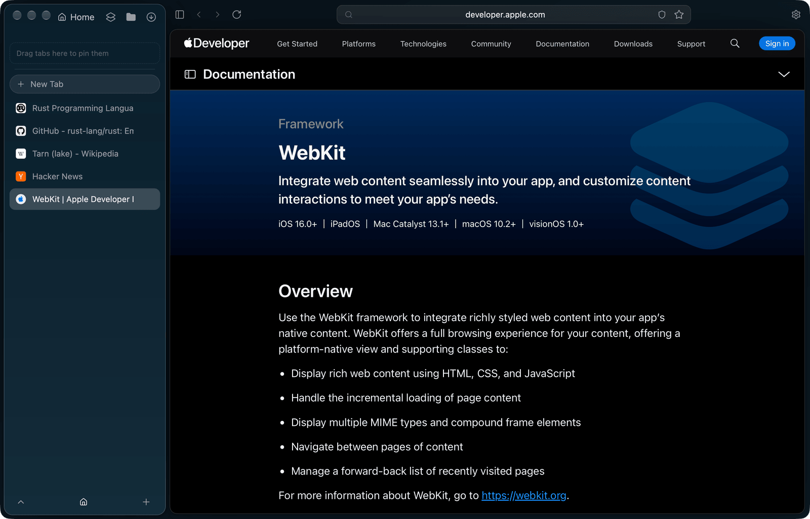
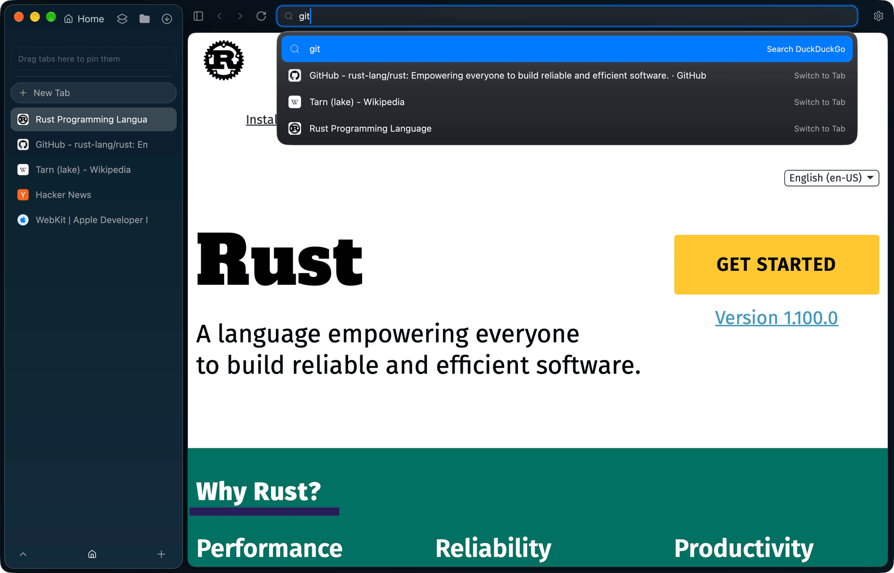
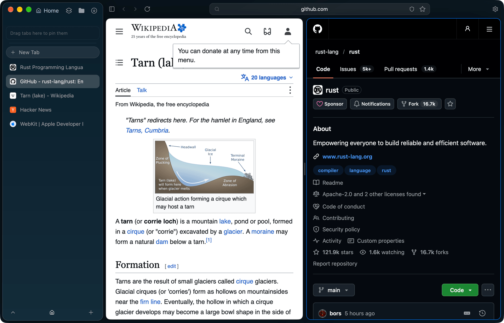
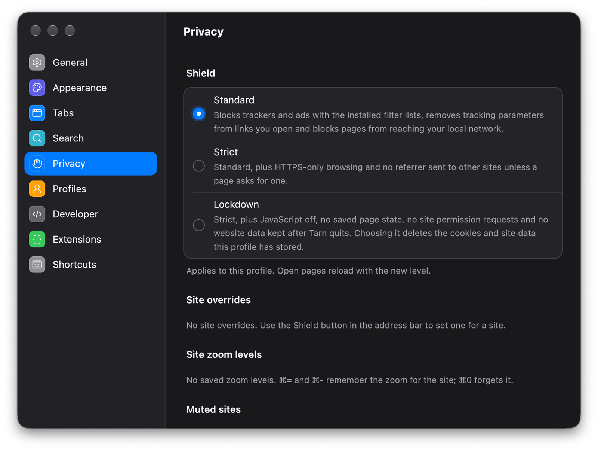

<div align="center">


# Tarn

**A fast, private, native macOS browser.**<br>
Rust shell, GPUI interface, system WebKit for pages. No telemetry, no accounts.

[Build and run](#build-and-run) · [Shortcuts](#shortcuts) · [Development](#development) · [Linux, iOS and Android](#linux-ios-and-android)

[](https://github.com/Quavon-dev/tarn-browser/actions/workflows/ci.yml)
[](LICENSE)


<sub>Full-quality clip: <a href="docs/media/demo.mp4">docs/media/demo.mp4</a></sub>

</div>

> [!NOTE]
> **Status:** pre-1.0. Tarn is in early development: features, settings and stored data can change
> between releases without a migration path.

## Highlights

- **Native, not Electron.** The window, sidebar and toolbar are drawn with GPUI; pages render in
  the system WebKit.
- **Private by default.** Shield blocks trackers and ads, strips tracking parameters and keeps pages
  off your local network. Strict adds HTTPS-only and no cross-site referrer; Lockdown turns off
  JavaScript and keeps no site data.
- **Blocking you can switch.** Ads (EasyList, AdGuard, uBlock filters, with ad placeholders
  hidden), trackers, cookie banners, YouTube ads, pop-ups and redirects to pop-up ad sites, malware, phishing and
  scam sites, and, if you turn it on, adult sites. Each is a switch in Settings › Privacy; ads, trackers
  and cookie banners can be turned off for one site from the Shield button. Lists are signed and updated
  daily; dangerous sites get a warning page drawn by Tarn, not the site.
- **Spaces and profiles.** Each space has its own name, colour and icon; profiles keep cookies,
  history and site data fully separate. Private spaces live in memory only.
- **Keyboard first.** One address field for URLs, search, open tabs and app actions, plus a
  shortcut for nearly everything (⌘/ shows them all).
- **Split View, link peek, tab groups**, pinned tabs that remember their page, and tabs that sleep
  when unused.

## Screenshots

<table>
  <tr>
    <td width="50%"></td>
    <td width="50%"></td>
  </tr>
  <tr>
    <td align="center"><sub>Vertical tabs in the sidebar</sub></td>
    <td align="center"><sub>One field for addresses, search and Switch to Tab</sub></td>
  </tr>
  <tr>
    <td width="50%"></td>
    <td width="50%"></td>
  </tr>
  <tr>
    <td align="center"><sub>Split View (⌃⌘N)</sub></td>
    <td align="center"><sub>Shortcut cheat sheet (⌘/)</sub></td>
  </tr>
  <tr>
    <td colspan="2" align="center"></td>
  </tr>
  <tr>
    <td colspan="2" align="center"><sub>Shield levels in Settings › Privacy</sub></td>
  </tr>
</table>

## Build and run

### System requirements

- macOS 14 Sonoma or later (`LSMinimumSystemVersion` in `packaging/Info.plist`).
- Apple silicon (arm64) or Intel (x86_64). `scripts/bundle.sh` builds for the Mac it runs on; there
  is no universal binary.
- To build: Xcode command line tools and the Rust toolchain pinned in `rust-toolchain.toml`
  (rustup installs it on first use).

### Run

```sh
cargo run -p app --release
cargo run -p app -- https://example.com   # open a URL in a new tab
```

Profile data lives in `~/Library/Application Support/Tarn`; set `TARN_DATA_DIR` to use another
directory. Debug builds also read `TARN_TEST_FILTER_KEY`, a 64-digit hex Ed25519 public key that
replaces the filter-list signing key so tests can install bundles they signed themselves, and
`TARN_TEST_CATALOG_KEY`, which replaces the extension catalog's signing key in the same way;
release builds ignore both.

## Shortcuts

The defaults; most can be changed in Settings › Shortcuts (tab and space numbers, Esc, Undo/Redo and
⌘Q stay fixed).

| Keys | Action |
|---|---|
| ⌘N | New window |
| ⌘T | New tab: the address field opens in the toolbar over a shown page, otherwise the command card, with the cursor in it |
| ⌘L | Edit the current tab's address in the toolbar |
| ⌘W | Close tab (pinned tabs and tiles are unloaded, not removed) |
| ⇧⌘T | Reopen closed tab |
| ⇧⌘K | Close all tabs |
| ⌘1 … ⌘8 / ⌘9 | Select tab 1–8 / the last tab (in sidebar order) |
| ⌃⇥ / ⌃⇧⇥ | Next / previous tab (wraps around) |
| ⇧⌘C | Copy link of the current tab |
| ⌥⇧⌘C | Copy link as Markdown, `[title](url)` (Copy Title is in the Tabs menu) |
| ⌃⌘N | Open or close Split View: the current tab beside the space's last used tab |
| ⌥⌘S | Screenshot of the visible page to Downloads and the clipboard (Save Page as PDF is in the File menu) |
| ⌃⌘P | Picture in Picture for the page's largest playing video |
| ⌘/ | Keyboard shortcut cheat sheet |
| ⌘D | Pin or unpin the current tab |
| ⌥⌘G | New tab group (with the current tab) |
| ⇧⌘D | Bookmark the current tab |
| ⇧⌘A | Library: open tabs, history and bookmarks |
| ⇧⌘J | Recent downloads |
| ⌥⌘B / ⌘Y | Manage bookmarks / show history (open the library) |
| ⌘M | Minimize the window |
| ⌃⌘F | Enter or exit full screen |
| ⌘H / ⌥⌘H | Hide Tarn / hide other apps (Show All is in the Tarn menu) |
| ⌘[ / ⌘] | Back / forward |
| ⌘R | Reload (the arrow spins while the page loads) |
| ⌘F / ⌘G / ⇧⌘G | Find in page / next / previous |
| ⌘P | Print |
| ⌘S | Show or hide the sidebar |
| ⌘, | Settings window (Shield level, site overrides, history); ⌘W or Esc closes it |
| ⌘= / ⌘- / ⌘0 | Zoom in / out / reset |
| ⌃1 … ⌃9 | Switch space |
| ⇧⌘S | New space: pick a profile or create a new, fully separate one; name, colour and icon |
| ⇧⌘N | Private space (memory only) |
| ⌘Z / ⇧⌘Z | Undo / redo |
| ⇧-click a link | Open it in a peek over the page; Open in Tab keeps its history, Esc or a click outside closes it |

Trackpad (Settings › Tabs › Trackpad gestures): swipe left or right over the sidebar to switch
spaces; swipe over the address field to step
through tabs; swipe right over the toolbar to show the sidebar. The mouse's back and forward
buttons always navigate.

In the address field and the command bar, an address already open in the profile offers Switch to
Tab first (other spaces show their name). An action name ("settings", "new space") or a leading `>`
lists app actions with their shortcuts. Typing the start of an address you have typed or bookmarked before, or have open, completes it
in place (the added part selected: type on to replace it, Backspace drops it, → keeps it); arrows or Tab / ⇧Tab move the selection, Enter runs it, Esc
or a click elsewhere closes the field.

Mute Site (Tabs menu, a tab's menu or the toolbar's menu) silences a host in the profile; an
unmute button shows in the address field while the page is muted.

Drag tabs between the tile grid, the pinned section, folders and the tab list. The Shield badge in
the address field opens Site Settings for the page: Shield level for the site, zoom, mute, the
permissions remembered for it, Clear Site Data… and whether the connection is encrypted; the
profile-wide level is set in Settings. Its "Always open in" picks a space for the host: new tabs of
it (links from other apps, ⌘-clicks, links that open a new window and addresses typed into a new tab)
then open there, while a script's pop-up (which keeps its opener) and links followed inside a tab
stay put. Settings › Profiles › Space Rules lists and removes them;
the private space neither sends tabs elsewhere nor receives them.

A pinned tab or tile remembers the page it was pinned on; once it shows another page its row gets a
↩ button (Return to <host> in the tab's menu and the Tabs menu, next to Set Pinned URL to Current
Page). Rename… (or a double-click on the row) gives a tab its own title until Reset Title. Tabs
without a live page are dimmed; Sleep Tab and Sleep Other Tabs unload them on demand. Library › Memory (or Show Memory Use in the
command bar) lists the space's tabs by the memory and CPU of their web content process, with Sleep
per tab and Sleep All Inactive Tabs; the sidebar's heavy-tab dot ranks by the same figures.
Once awake background tabs hold more than 1 GB together, the heaviest of those unused for a minute
sleep, pinned tabs only after 30 minutes unused (tabs playing media stay awake; off when sleeping is
Never).
Chromium tabs are not measured. Resting the
pointer on a tab row shows its full title, address and state.
Right-click a space (its name or icon) and choose Edit Space… to change its name, colour and icon.

## Development

```sh
cargo test --workspace
cargo clippy --workspace --all-targets -- -D warnings
cargo deny check
```

On-device translation is behind the `translation` feature (`cargo run -p app --features
translation`; `TARN_EXTRA_FEATURES=app/translation scripts/bundle.sh` for a bundle); it needs a
Swift toolchain with the macOS 26 SDK. Its build script reads
`MACOSX_DEPLOYMENT_TARGET` (default `14.0`) for the Swift shim, which weak-links the Translation
framework, and Cargo's own `OUT_DIR` and `CARGO_CFG_TARGET_ARCH`. `TARN_TEST_TRANSLATION=1` runs
its integration test, which needs an installed German–English language pack. The framework must stay weak-linked so the app starts on macOS 14: `otool -l target/debug/tarn | grep -A2 LC_LOAD_WEAK_DYLIB` lists `Translation.framework`.

`unsafe` code is allowed only in `crates/engine` (and later `crates/platform`); every other crate
is `#![forbid(unsafe_code)]`.

### Startup timing

`TARN_STARTUP_TRACE=1` makes the app print `tarn-startup <unix ms> <ms since main> <step>` to
stderr when each startup step first finishes: `main`, `store open`, `first window render`,
`built-in rules attached`, `youtube rules attached`, `filter lists attached` and `first page
commit`. Without the variable nothing is printed; the output never names a URL.
`scripts/startup-trace.sh [runs] [url]` builds the release binary, launches it `runs` times
(default 5) against a temporary data folder, restoring one tab of `url` (default
`https://example.com/`), and prints each step's median. It opens windows and loads a page over the
network, so it runs on a Mac desktop session, not in CI; compare its output before and after a
startup change on the same machine. WebKit keeps the temporary profile's website data store under
`~/Library/WebKit`.

### Filter-list signing key

`FILTER_SIGNING_KEY` holds the base64 Ed25519 seed that `filter-bundle build` signs filter-list
bundles with. It lives only in a GitHub Actions secret used by the `Filter lists` workflow;
`filter-bundle keygen` prints it once to the terminal during setup. Never store it in the
repository. Setup and rotation: [`docs/filter-lists.md`](docs/filter-lists.md).

## Packaging

```sh
TARN_SIGN_IDENTITY=<team identity> scripts/bundle.sh   # target/release/Tarn.app with CEF, helpers and pinned Sparkle
scripts/check-entitlements.sh   # fails if the signed entitlements differ from the expected set
scripts/third-party-licenses.sh # regenerates the macOS and Windows licence lists in packaging/ after a dependency change
```

`TARN_SIGN_IDENTITY=none` leaves the bundle unsigned for the signing Mac; an ad-hoc signature
cannot load the CEF framework. The app runs without the App Sandbox (Chromium's helpers and
WebKit's content processes keep theirs): its data lives in `~/Library/Application Support/Tarn`
and `~/Library/WebKit/dev.tarn.browser`, and the first start after a sandboxed version moves it
there once. WebKit stays the default engine; Chromium is offered while automatic updates are on.
A bundle whose update feed it cannot reach (a private repository, or no release yet) never gets a
verified check and so never opens Chromium; `TARN_LOCAL_CHROMIUM=1 TARN_SIGN_IDENTITY=<identity>
scripts/bundle.sh` builds one that opens it until 28 days after its CEF release, for your own Mac.
The bundle carries Chromium's credits, CEF's and Sparkle's licences and the Rust crates' licences
(Settings › General › About). Signing, notarisation and releases are described in
[`docs/release.md`](docs/release.md).

## Linux, iOS and Android

Tarn for Linux, iOS and Android is built on [Native Shell](https://nsh.dev/) 0.5.0 over the same
`browser-core`, `engine` and `shield` crates, with each platform's own web engine: WebKitGTK 6.0 from
the distribution, `WKWebView` (iOS 17 or later) and the system WebView (Android 9 or later). Plan:
[`docs/nsh-plan.md`](docs/nsh-plan.md) and [`docs/mobile-plan.md`](docs/mobile-plan.md); security
differences from macOS: [`docs/threat-model.md`](docs/threat-model.md) ("iOS, Android and Linux"). Each
has its own Cargo workspace, so NSH stays out of the root workspace.

| Directory | What |
|---|---|
| `nsh-shared/` | Theme tokens, icons and controls shared by the three apps (`cargo test` there) |
| `linux/` | The Linux desktop app ([`linux/README.md`](linux/README.md)) |
| `mobile/` | The phone and tablet app (`app/`), the iOS web view (`ios/`) and the Android host app (`android/`, [`mobile/android/README.md`](mobile/android/README.md)) |

```sh
# Linux, in a Fedora 43 container (no Linux desktop needed)
docker build -t tarn-linux-fedora -f linux/docker/fedora.Dockerfile linux/docker
linux/scripts/cargo.sh test --locked && linux/scripts/test-display.sh
linux/packaging/build-all.sh deb-debian|deb-ubuntu|rpm|arch    # .deb, .rpm, AUR package

# Mobile (nsh 0.5.0 on PATH: https://nsh.dev/docs/installation)
cd mobile && cargo test --locked                               # shell and UI tests on the host
cd mobile/app && nsh package --target ios-simulator            # iOS simulator app
mobile/android/build.sh                                        # debug APK (ANDROID_HOME, NDK, JDK 17+)
```

Packages: `.deb` for Debian 13 and Ubuntu 26.04, `.rpm` for Fedora 43 and an AUR `PKGBUILD`, each
depending on the distribution's WebKitGTK 6.0; no Flatpak or AppImage. The iOS and Android apps have no
signed or store builds yet.

Verified so far: the Linux app in Docker under Xvfb (Fedora 43; packages installed and started on Debian
13, Ubuntu 26.04, Fedora 43 and Arch); the mobile app in the iOS simulator (iPhone 17, iPad Pro 13-inch)
and the Android emulator (phone and 10-inch tablet, Android 16). Not yet: a real Linux desktop, HiDPI,
IME, VoiceOver and TalkBack, physical iPhones, iPads or Android devices, and amd64 Linux packages.

## Licence

Tarn is free software under the GNU General Public License, version 3 or (at your option) any later
version (`GPL-3.0-or-later`); see [`LICENSE`](LICENSE). An additional permission in
[`LICENSE-APP-STORE.md`](LICENSE-APP-STORE.md) allows only Quavon UG (haftungsbeschränkt) to
distribute Tarn through app stores such as Apple's App Store. The Tarn name, logo and app icon are
trademarks; forks need a name and icons of their own ([`TRADEMARKS.md`](TRADEMARKS.md)). Third-party licences shipped with the app
are in [`packaging/third-party-licenses.txt`](packaging/third-party-licenses.txt).
